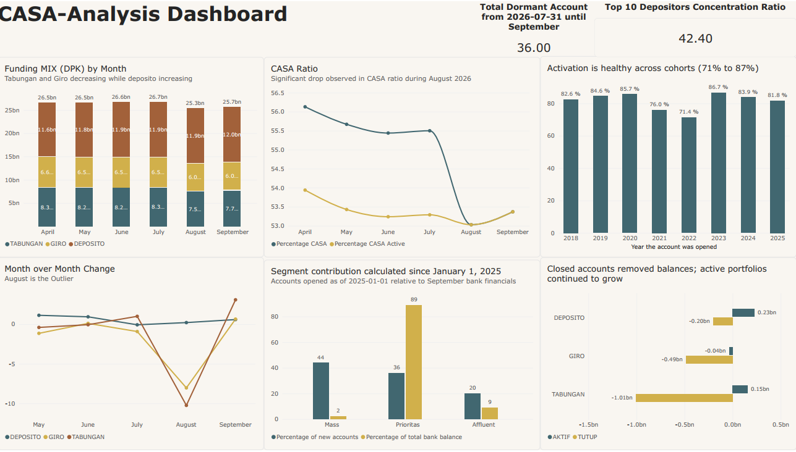

# Retail Funding Analytics: Why Did the CASA Ratio Drop?

**A SQL case study on deposit (DPK) composition, account closures, and new-account quality**
Tools: MySQL 8 (CTEs, window functions) · Python (matplotlib) · synthetic banking data

> **Data notice.** All data in this repository is **synthetic** and was generated by `scripts/generate_data.py`. It is not real customer data and does not come from any bank. The synthetic data contains patterns that were built in on purpose, so the findings below demonstrate an **analysis method**, not real-world behavior.

---

## Business context

In retail banking, funding teams track the **CASA ratio** = (current accounts + savings accounts) / total deposits (DPK). CASA is "cheap money": it pays low interest, so a higher share lowers the bank's cost of funds and widens its interest margin. When the ratio falls, the first question is *why*: are customers moving money into expensive time deposits, are they leaving, or is it something else?

Public context: Bank Rakyat Indonesia reported its CASA ratio rising from 65.5% to 67.6% year over year in Q2 2026, and described CASA as a strategic priority ([Investortrust](https://investortrust.id/financial/115645/kepercayaan-nasabah-tinggi-dpk-bri-rp-1580-triliun-dan-didominasi-casa)). This project is independent and not affiliated with BRI.

## Two business questions

1. **Case 1.** The CASA ratio fell from 55.5% (July) to 53.0% (August). What caused it?
2. **Case 2.** The branch network opened many new accounts. Is that translating into balances, and are the new accounts being used?

## Dataset (synthetic)

| Table | Rows | Description |
|---|---|---|
| `nasabah` | 200 | Customers: segment (Mass / Affluent / Prioritas), city, age |
| `rekening` | 252 | Accounts: product (GIRO / TABUNGAN / DEPOSITO), status (AKTIF / TUTUP) |
| `saldo_bulanan` | 1,512 | Month-end balance snapshots, April to September 2026 |
| `transaksi` | 2,841 | Transactions with channel (ATM, BRImo, QRIS, ...) |
| `deposito` | 60 | Time-deposit certificates (not used in these two cases) |

Definitions used: **New account** = opened on or after 2025-01-01. **Active** = at least one transaction in the last 90 days (reference date 2026-10-25). **Dormant** = status AKTIF but not active.

---

## Executive Summary & Key Findings
### Dashboard Preview

### Case 1: What Caused the CASA Ratio Drop?
* The Problem: Total DPK remained stable at ~Rp26.5B through July before dropping 5.05% to Rp25.3B in August, recovering back to ~Rp25.7B in September. Month-over-month analysis shows giro and tabungan dropped sharply by -8.04% and -10.25% in August while deposito remained flat, dragging down the CASA ratio.
* Root Cause (Closures vs. Active Drawdowns): Splitting July-to-August balance changes by account status revealed that the contraction was entirely driven by account closures (21 closed accounts removed Rp1,692M), whereas active accounts actually grew by Rp345M (+1.4%).
* Concentration Risk: While 16 of the 21 closed accounts belonged to the Mass segment, 3 Prioritas accounts accounted for 84.3% (Rp1,426M) of the lost balance. Furthermore, the Top 10 depositors concentration ratio stands at 42.40%, highlighting high vulnerability to single-client liquidity shocks.

### Case 2: New Accounts & Dormancy Analysis
* Acquisition vs. Balance Weight: Across accounts opened since 2025, Mass accounts represent 44% of total new accounts but contribute only 2.2% of the balance, whereas Prioritas accounts make up 36% of new accounts and hold 89.0% of the balance.
* Cohort Activation: Activation rates across all historical cohorts remain healthy between 71% and 87% (with the 2025 cohort at 81.8%).
* Dormant Accounts: A total of 36 dormant accounts were identified between July and September, representing a prime target for balance-based reactivation campaigns.

---

## Strategic Recommendations

1. Adjust Reporting Metrics: Report CASA ratios both with and without one-off account closures to prevent executive misinterpretation of core portfolio health.
2. Implement Early-Warning Watchlists: Monitor high-balance Prioritas accounts for sudden drops in transaction frequency or balance as an early indicator of churn.
3. Concentration Monitoring: Track the top-10 depositor concentration ratio (currently at 42.40%) alongside daily liquidity buffers.
4. Targeted Dormancy Reactivation: Focus outreach efforts on sleeping balances rather than raw account counts to maximize capital reactivation efficiency.

---

## Data quality checks

- No NULLs or empty categories; no duplicate primary keys; no orphan accounts, balances, or transactions.
- Category values are consistent (`GIRO/TABUNGAN/DEPOSITO`, `AKTIF/TUTUP`, `Mass/Affluent/Prioritas`).
- **Fan-out guard:** balances are never joined directly to transactions (that multiplies balances: a naive join gave Rp203 billion vs the correct Rp25.65 billion). Dormancy uses `NOT EXISTS`, and totals were reconciled against `SELECT SUM(saldo)` on the source table.
- `transaksi` contains 8 duplicate rows inserted on purpose for a separate data-cleaning exercise; they do not affect the queries in these two cases.

## Limitations

- **Synthetic data:** the August closure event was built into the data. The value of this project is the method, the reasoning order, and the checks, not the specific numbers.
- **Month-end snapshots** can hide intra-month movement and window-dressing; average daily balance would be better where available.
- **Small sample** (252 accounts); percentages move a lot with one account.
- **Definitions are assumptions** (new = since 2025, active = 90 days). A real bank would set these by policy.
- The analysis shows *what* changed and *where*; it does not prove *why* customers left.

## Skills demonstrated

SQL (CTEs, `LAG`, `ROW_NUMBER`, `SUM() OVER`, conditional aggregation with `CASE WHEN`, `EXISTS` / `NOT EXISTS`, multi-table joins) · root-cause decomposition · counterfactual analysis · segmentation · cohort activation · data validation and reconciliation · business recommendations from data
